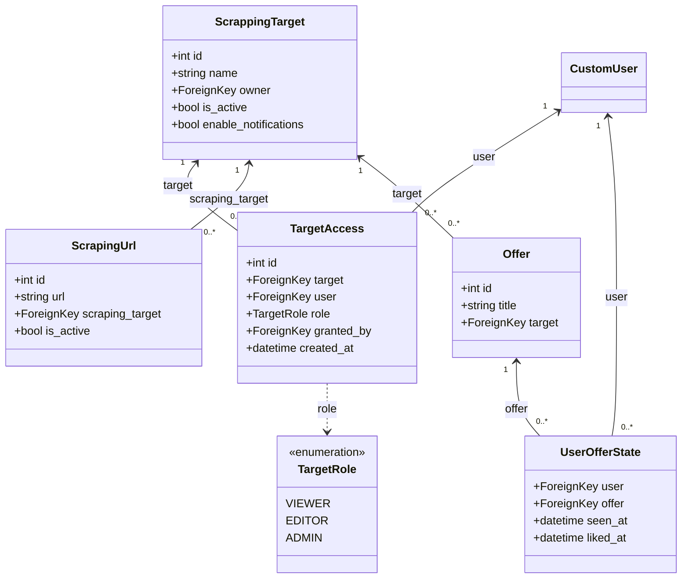

# Plan Implementacji: System Uprawnień TargetAccess dla ScrapingTarget

## Cel i Kontekst

Celem jest wdrożenie czystego, domenowego systemu uprawnień dla `ScrappingTarget`, umożliwiającego współdzielenie celów scrapowania pomiędzy użytkownikami z podziałem na role.

Główne założenia architektoniczne:
1. **Model `ScrappingTarget` pozostaje czysty**: nie dodajemy do niego pola `ManyToManyField` do `User`. `ScrappingTarget` nie powinien być świadomy warstwy nadań uprawnień ani kusić bezpośrednim `target.shared_users.add()`, co omijałoby role i audyt. Relacja jest modelowana wyłącznie przez `TargetAccess` (`target = ForeignKey(...)`).
2. **Separacja odpowiedzialności: Widoczność vs Autoryzacja**:
   - `QuerySet.for_user(user_id)` odpowiada **wyłącznie za zasięg widoczności** (cele, do których użytkownik ma jakikolwiek dostęp — jako właściciel lub członek).
   - Sprawdzanie uprawnień do konkretnej operacji (np. `can_manage_urls`, `can_manage_target`) znajduje się w **warstwie aplikacji / polityki dostępu**. Dzięki temu użytkownik z rolą `VIEWER` próbujący dodać URL otrzyma precyzyjny błąd **403 Forbidden** (`TargetPermissionDenied`), a nie mylący błąd **404 Not Found** (`TargetDoesNotExist`).



---

## Podział Odpowiedzialności i Role

### 1. Role domenowe (`TargetRole`)
- **`VIEWER`**:
  - Dostęp do celów scrapowania na liście i w szczegółach (`list_targets`, `get_target`).
  - Podgląd adresów URL (tylko do odczytu).
  - Przeglądanie ofert w inboxie (`/offers`).
  - Prywatny triage inboxa (oznaczanie jako przeczytane/polubione w `UserOfferState` wyłącznie dla tego usera).
  - **Zabronione**: modyfikacja URL-i, dodawanie URL-i, usuwanie URL-i, modyfikacja targetu.
- **`EDITOR`**:
  - Wszystko co `VIEWER`.
  - Pełne zarządzanie linkami: dodawanie nowych URL-i (w ramach limitu `target.owner`), edycja parametrów/filtrów, usuwanie, włączanie/wyłączanie.
- **`ADMIN`**:
  - Wszystko co `EDITOR`.
  - Modyfikacja ustawień targetu: zmiana nazwy targetu, włączanie/wyłączanie powiadomień, wysyłanie testowych powiadomień, zmiana kanału powiadomień.
- **`OWNER`** (`target.owner`):
  - Właściciel konta.
  - Wyłącznie `owner` może usunąć cały cel scrapowania (`delete_target`) i zarządzać subskrypcją/kwotami.

---

## Proponowane Zmiany w Kodzie

```
shargain/
├── offers/
│   ├── models.py                  # Model TargetAccess, TargetRole, proste QuerySety .for_user(user_id)
│   ├── migrations/                # Nowa migracja 0027_targetaccess
│   ├── admin/
│   │   ├── inlines.py             # TargetAccessInline (TabularInline na TargetAccess)
│   │   ├── forms.py               # Walidacja TargetAccessInline (owner != user)
│   │   └── __init__.py            # Wpięcie inline do ScrappingTargetAdmin + TargetAccessAdmin
│   ├── application/
│   │   ├── exceptions.py          # TargetPermissionDenied
│   │   ├── access.py              # Funkcje polityki uprawnień (can_manage_urls, can_manage_target)
│   │   ├── commands/              # Autoryzacja operacji w komendach
│   │   └── queries/               # Filtrowanie celów przez for_user(user_id)
│   └── tests/
│       ├── factories.py           # TargetAccessFactory
│       └── ...                    # Testy uprawnień
├── public_api/
│   └── api.py                     # Obsługa TargetPermissionDenied -> 403 Forbidden
└── quotas/
    └── services/quota.py          # Liczenie URL w targecie i prezentacja kwot w oparciu o ownera
```

---

### Komponent 1: Warstwa Modeli i Migracji (`shargain/offers`)

#### `shargain/offers/models.py`
1. Definicja ról:
```python
class TargetRole(models.TextChoices):
    VIEWER = "viewer", _("Viewer")
    EDITOR = "editor", _("Editor")
    ADMIN = "admin", _("Admin")
```

2. Model `TargetAccess`:
```python
class TargetAccess(TimeStampedModel):
    target = models.ForeignKey(
        "ScrappingTarget",
        on_delete=models.CASCADE,
        related_name="accesses",
        verbose_name=_("Scraping target"),
    )
    user = models.ForeignKey(
        settings.AUTH_USER_MODEL,
        on_delete=models.CASCADE,
        related_name="target_accesses",
        verbose_name=_("User"),
    )
    role = models.CharField(
        verbose_name=_("Role"),
        max_length=20,
        choices=TargetRole.choices,
        default=TargetRole.EDITOR,
    )
    granted_by = models.ForeignKey(
        settings.AUTH_USER_MODEL,
        on_delete=models.SET_NULL,
        null=True,
        blank=True,
        related_name="+",
        verbose_name=_("Granted by"),
    )

    class Meta:
        verbose_name = _("Target access")
        verbose_name_plural = _("Target accesses")
        constraints = [
            models.UniqueConstraint(
                fields=["target", "user"],
                name="uniq_target_user_access",
            ),
        ]

    def __str__(self) -> str:
        return f"{self.user} - {self.target} ({self.get_role_display()})"
```

3. Na modelu `ScrappingTarget`:
   - **NIE** dodajemy pola `ManyToManyField(CustomUser)`!
   - `ScrappingTarget` pozostaje czysty; dostęp przez `target.accesses.all()` jest jawny.

4. Czyste QuerySety (odpowiedzialne **wyłącznie za widoczność** `user_id`, bez logiki `min_role`):
```python
class ScrappingTargetQuerySet(QuerySet):
    def for_user(self, user_id: int | None) -> QuerySet["ScrappingTarget"]:
        if not user_id:
            return self.none()
        return self.filter(Q(owner_id=user_id) | Q(accesses__user_id=user_id)).distinct()


class ScrapingUrlQuerySet(QuerySet):
    def for_user(self, user_id: int | None) -> QuerySet["ScrapingUrl"]:
        if not user_id:
            return self.none()
        return self.filter(
            Q(scraping_target__owner_id=user_id) | Q(scraping_target__accesses__user_id=user_id)
        ).distinct()


class OfferQueryset(QuerySet):
    def for_user(self, user_id: int | None) -> QuerySet["Offer"]:
        if not user_id:
            return self.none()
        return self.filter(
            Q(target__owner_id=user_id) | Q(target__accesses__user_id=user_id)
        ).distinct()
```

---

### Komponent 2: Polityka Uprawnień (`shargain/offers/application/access.py`)

Jawna, testowalna polityka uprawnień w warstwie aplikacji:
```python
from shargain.offers.models import ScrappingTarget, TargetAccess, TargetRole

def get_user_role(user_id: int, target: ScrappingTarget) -> TargetRole | str | None:
    if target.owner_id == user_id:
        return "owner"
    access = target.accesses.filter(user_id=user_id).first()
    return TargetRole(access.role) if access else None

def can_view_target(user_id: int, target: ScrappingTarget) -> bool:
    return target.owner_id == user_id or target.accesses.filter(user_id=user_id).exists()

def can_manage_urls(user_id: int, target: ScrappingTarget) -> bool:
    if target.owner_id == user_id:
        return True
    return target.accesses.filter(
        user_id=user_id,
        role__in=[TargetRole.EDITOR, TargetRole.ADMIN],
    ).exists()

def can_manage_target(user_id: int, target: ScrappingTarget) -> bool:
    if target.owner_id == user_id:
        return True
    return target.accesses.filter(
        user_id=user_id,
        role=TargetRole.ADMIN,
    ).exists()

def can_delete_target(user_id: int, target: ScrappingTarget) -> bool:
    return target.owner_id == user_id
```

`shargain/offers/application/exceptions.py`:
```python
class TargetPermissionDenied(ApplicationException):
    code = "target_permission_denied"
    message = "You do not have permission to perform this action on the target."
```

---

### Komponent 3: Panel Django Admin (`shargain/offers/admin`)

- `TargetAccessInline(admin.TabularInline)` podpięty do `ScrappingTargetAdmin.inlines`.
- Formularz z walidacją blokującą dodanie właściciela celu (`target.owner`) jako wpisu w `TargetAccess`.
- Rejestracja `TargetAccessAdmin` jako osobnego widoku w panelu admina dla audytu nadań.

---

### Komponent 4: Komendy i Zapytania Aplikacji (`shargain/offers/application`)

#### Odczyt (Queries):
1. `list_targets.py`:
   - Pobiera targety przez `ScrappingTarget.objects.for_user(actor.user_id)`.
   - `Count("scrapingurl", distinct=True)`.
2. `get_target.py`:
   - `get_target`: `ScrappingTarget.objects.for_user(actor.user_id).get(id=target_id)`.
   - `get_target_by_user`: pobranie celu z priorytetyzacją własnych (`owner_id=actor.user_id`), potem współdzielonych.
3. `get_scraping_url.py`:
   - `ScrapingUrl.objects.for_user(actor.user_id).get(id=url_id)`.
4. `list_public_offers.py`:
   - Sprawdza dostęp do targetu: `ScrappingTarget.objects.for_user(actor.user_id).filter(pk=target_id).exists()`.
   - Pobiera oferty i nawadnia stan `UserOfferState` dla bieżącego `actor.user_id`.

#### Zapis (Commands):
Każda komenda najpierw pobiera obiekt przez `for_user(actor.user_id)` (brak obiektu = `404 Not Found`), a następnie sprawdza politykę (brak uprawnień = `403 TargetPermissionDenied`):

1. `add_scraping_url.py`:
   - Pobiera `target = ScrappingTarget.objects.for_user(actor.user_id).get(id=target_id)`.
   - Weryfikuje `can_manage_urls(actor.user_id, target)`. Jeśli fałsz -> `TargetPermissionDenied`.
   - Weryfikuje limit: `QuotaService.check_can_add_url(user_id=target.owner_id or actor.user_id, target_id=target.id)`.
2. `update_scraping_url.py`:
   - Pobiera `url = ScrapingUrl.objects.for_user(actor.user_id).get(id=url_id)`.
   - Weryfikuje `can_manage_urls(actor.user_id, url.scraping_target)`. Jeśli fałsz -> `TargetPermissionDenied`.
3. `delete_scraping_url.py`:
   - Pobiera `url = ScrapingUrl.objects.for_user(actor.user_id).get(id=url_id)`.
   - Weryfikuje `can_manage_urls(actor.user_id, url.scraping_target)`. Jeśli fałsz -> `TargetPermissionDenied`.
4. `set_scraping_url_active_status.py`:
   - Pobiera link, weryfikuje `can_manage_urls`. Jeśli fałsz -> `TargetPermissionDenied`.
5. Komendy celów (`update_scraping_target_name`, `toggle_target_active`, `toggle_target_notifications`, `send_test_notification`):
   - Weryfikują `can_manage_target(actor.user_id, target)`. Jeśli fałsz -> `TargetPermissionDenied`.
6. `delete_target.py`:
   - Weryfikuje `can_delete_target(actor.user_id, target)`. Tylko `owner` może usunąć target.
7. `offer_state.py` (`_validate_actor_offers`):
   - Używa `Offer.objects.for_user(actor.user_id)` — każdy z dostępem (nawet `VIEWER`) może oznaczać przeczytane i polubione dla siebie.

---

### Komponent 5: Public API & Quotas

- `shargain/public_api/api.py`: obsługa wyjątku `TargetPermissionDenied` -> HTTP 403 Forbidden.
- `shargain/quotas/services/quota.py`:
  - `check_can_add_url`: zliczanie `ScrapingUrl.objects.filter(scraping_target_id=target_id).count()`.
  - `get_quota_status`: pobieranie celów przez `ScrappingTarget.objects.for_user(user_id)` i prezentacja limitów w oparciu o kwotę właściciela (`target.owner_id or user_id`).

---

## Plan Weryfikacji i Testów

### 1. Testy Automatyczne (Backend)
```bash
uv run pytest shargain/offers/tests/ shargain/public_api/tests/ shargain/quotas/tests/
```

Zakres testów:
1. `ScrappingTarget` nie posiada atrybutu `shared_users`. Relacja odbywa się wyłącznie przez `TargetAccess`.
2. QuerySet `for_user`: zwraca cele własne oraz z nadanym `TargetAccess`.
3. Polityka uprawnień (`access.py`):
   - `VIEWER`: widzi cel, URL-e, oferty. Zapisywanie/edycja/usuwanie URL rzuca `TargetPermissionDenied` (403 w API).
   - `EDITOR`: dodaje/edytuje/usuwa URL. Próba zmiany nazwy targetu rzuca `TargetPermissionDenied`.
   - `ADMIN`: może zmieniać nazwę targetu i powiadomienia.
   - `OWNER`: pełne uprawnienia łącznie z usunięciem targetu.
4. Triage ofert w inboxie: `VIEWER` i `EDITOR` przeglądają oferty i oznaczają je `seen` / `liked`. Stan zapisuje się per-user.
5. Django Admin: zapisanie i renderowanie `TargetAccessInline`. Blokada dodania `target.owner` do `TargetAccess`.
6. Kwoty: `GET /api/public/quota/status` zwraca status dla współdzielonego targetu.

### 2. Narzędzia Jakości Kodu
```bash
just quality-check
pnpm -C frontend lint
pnpm -C frontend test
```
