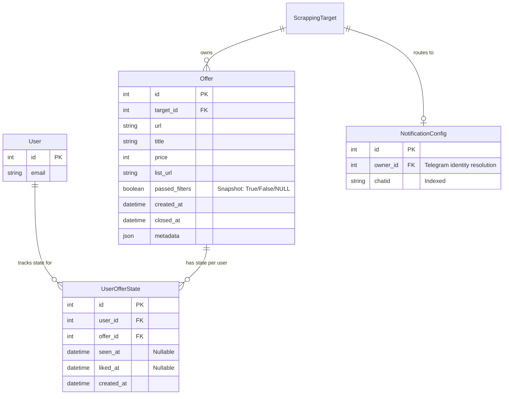
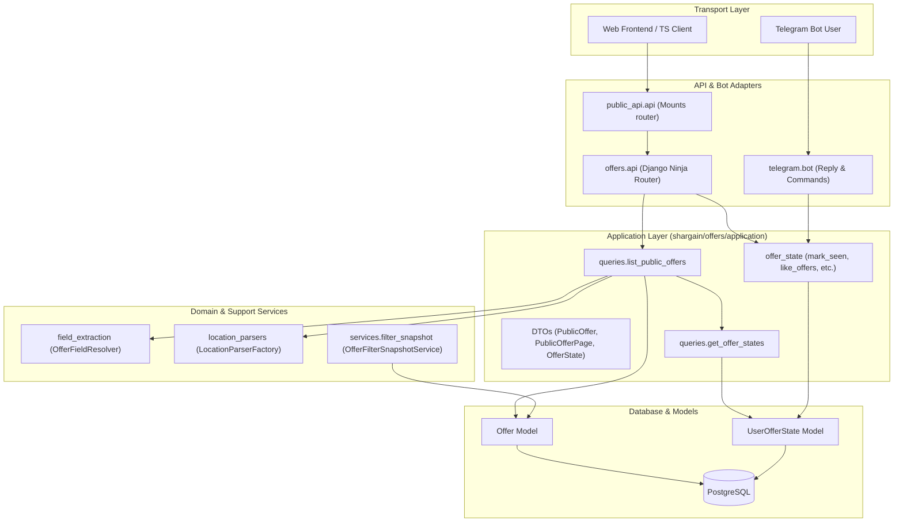
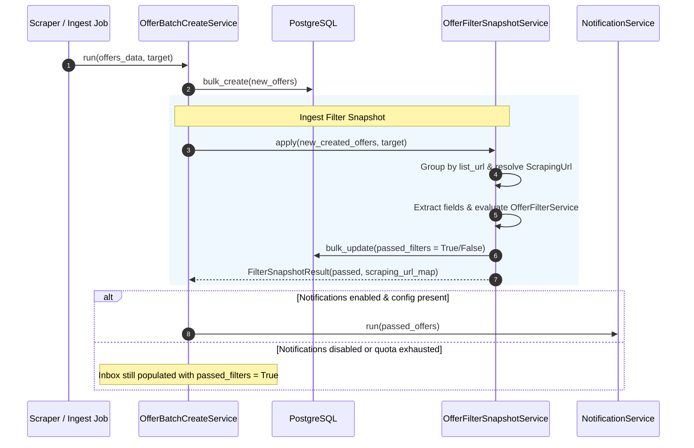
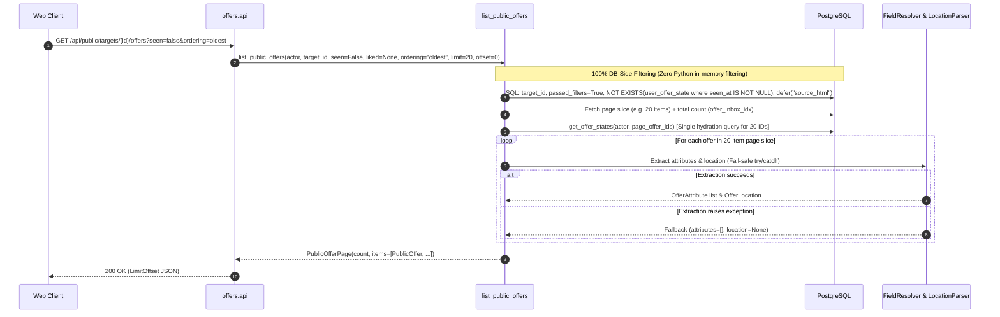
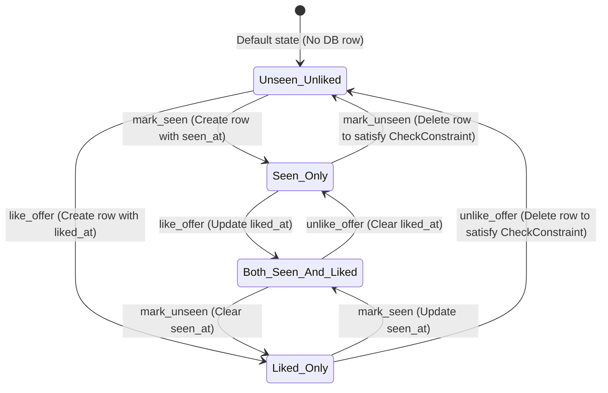

# Offer Inbox — Architecture & Changes Diagrams

This document visualizes the architecture, data models, ingest pipeline, and request lifecycles defined in [2026-11-07-offer-inbox-backend-design.md](file:///home/nekeal/projects/python/shargain/docs/superpowers/specs/2026-11-07-offer-inbox-backend-design.md).

---

## 1. Data Model Evolution (ER Diagram)

Replacing the single-purpose `OfferLike` model with `UserOfferState`, and capturing filter pass/fail status directly at ingest time via `passed_filters`.

---

## 2. Component & Layer Architecture

Layer dependencies flow strictly inward. The HTTP API and Telegram bot act as thin transport adapters interacting through application-layer DTOs, queries, and commands without leaking ORM internals.

---

## 3. Ingest Pipeline: Filter Snapshot & Notification Decoupling

`OfferBatchCreateService` snapshots filter evaluation into `Offer.passed_filters` regardless of notification settings or delivery failures.

---

## 4. Inbox Read Flow (`list_public_offers`)

Assembling the public read model with 100% database-side filtering (via `Exists` subqueries), column deferrals, single-query state hydration, and resilient in-memory projection for the paginated slice only.

---

## 5. State Transition Lifecycle (`UserOfferState`)

Illustrates state persistence, idempotency, and the `CheckConstraint` deletion rules.

